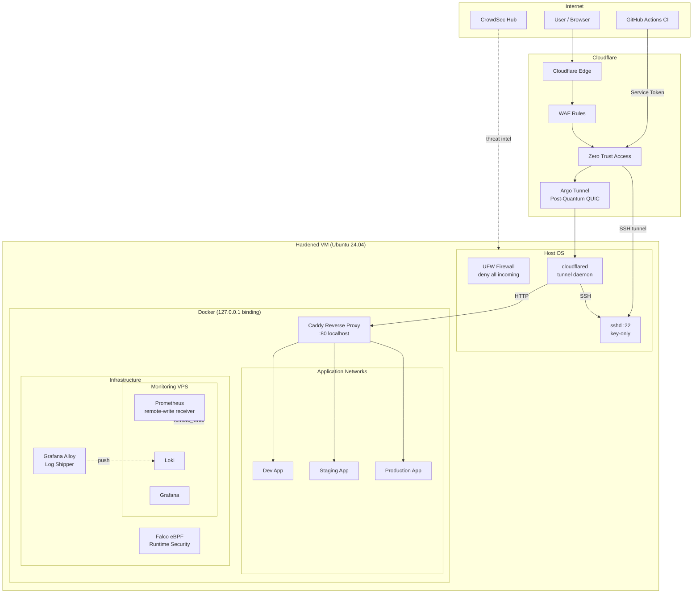
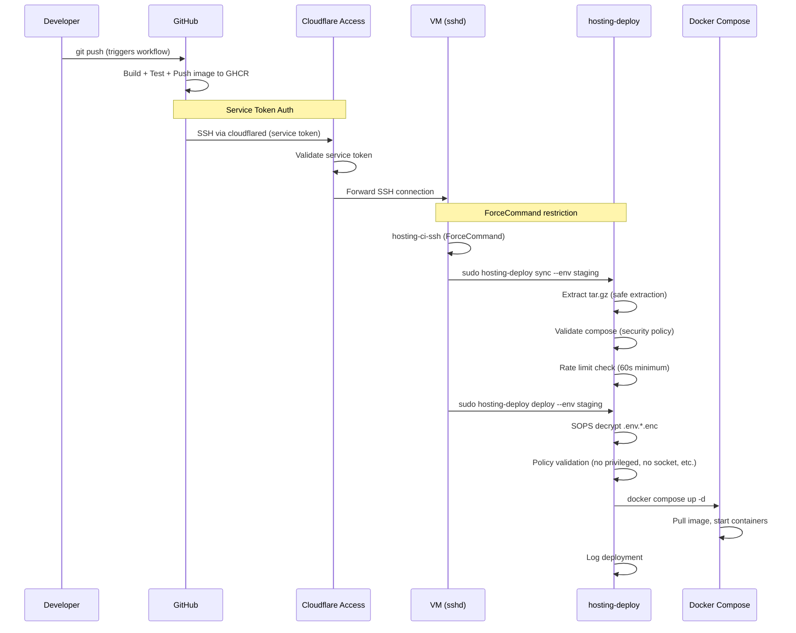
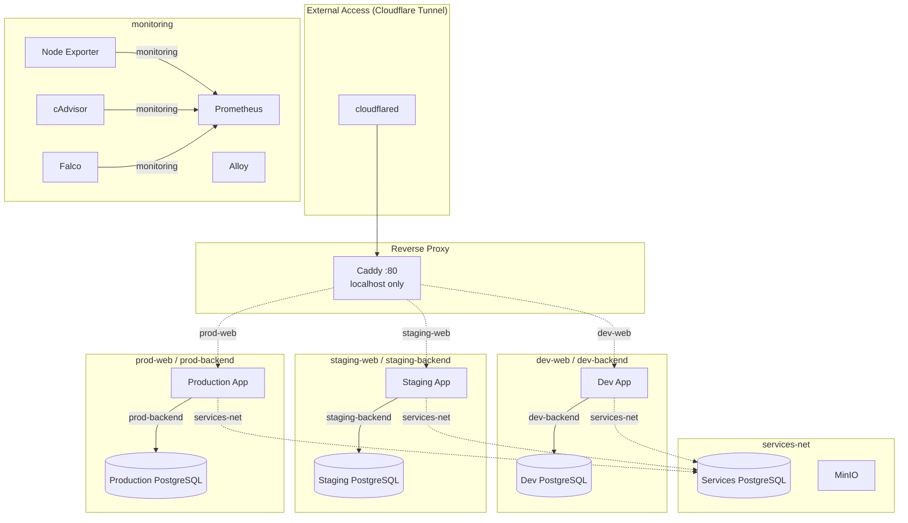

# Architecture Diagrams

Visual representations of the hosting-blueprint architecture.

## Network Flow



## Security Layers

```mermaid
graph LR
    subgraph Layer1["Layer 1: Edge (Cloudflare)"]
        WAF[Managed WAF]
        DDoS[DDoS Protection]
        BotMgmt[Bot Management]
        CustomRules[Custom Rules<br/>5 rules]
        RateLimit[Rate Limiting<br/>login/auth]
    end

    subgraph Layer2["Layer 2: Access (Zero Trust)"]
        AzureAD[Azure AD IdP]
        AccessApps[Access Applications]
        ServiceTokens[Service Tokens<br/>CI/CD]
    end

    subgraph Layer3["Layer 3: Transport"]
        Tunnel[Cloudflare Tunnel<br/>Post-Quantum QUIC]
        NoPublicPorts[Zero Public Ports<br/>UFW deny all]
    end

    subgraph Layer4["Layer 4: Host OS"]
        UFW[UFW Firewall]
        fail2ban[fail2ban]
        CrowdSec[CrowdSec + Bouncer<br/>deny_log]
        Auditd[auditd]
        SSH[SSH Hardening<br/>key-only, AllowUsers]
        Sysctl[Kernel Hardening<br/>sysctl]
        AppArmor[AppArmor]
    end

    subgraph Layer5["Layer 5: Container"]
        NoPrivileged[No Privileged<br/>hosting-deploy policy]
        NoSocket[No Docker Socket]
        NoPublish[No Port Publishing]
        ResourceLimits[CPU/Memory/PID Limits]
        ReadOnly[Read-Only Filesystems]
        NoNewPriv[no-new-privileges]
        ICC[ICC Disabled<br/>default bridge]
        Falco[Falco eBPF<br/>Runtime Detection]
    end

    subgraph Layer6["Layer 6: Secrets"]
        SOPS[SOPS + age<br/>Encrypted at rest]
        FileSecrets[File-based Secrets<br/>GID 1999]
        NoEnvSecrets[No env var secrets]
    end

    subgraph Layer7["Layer 7: Monitoring"]
        Prometheus[Prometheus Metrics]
        Loki[Log Shipping to Loki]
        Trivy[Trivy CVE Scans<br/>Weekly]
        AIDE[AIDE File Integrity<br/>Daily]
        rkhunter[rkhunter<br/>Weekly]
    end

    Layer1 --> Layer2 --> Layer3 --> Layer4 --> Layer5 --> Layer6
    Layer4 --> Layer7
    Layer5 --> Layer7
```



## CI/CD Trust Chain



## Backup Pipeline

```mermaid
graph TB
    subgraph Daily["Daily (02:00 - 02:45 UTC)"]
        DB[Database Dumps<br/>PostgreSQL pg_dump]
        N8N[n8n Exports<br/>Workflows + Credentials]
        MinIO[MinIO Mirror<br/>mc mirror]
        Retention[Retention Cleanup<br/>30-day rotation]
        Restic[Restic Off-Site<br/>Encrypted + Deduplicated]
    end

    subgraph Weekly["Weekly (Sunday)"]
        ResticCheck[Restic Integrity Check]
        ResticPrune[Restic Prune<br/>7 daily, 4 weekly, 6 monthly]
    end

    subgraph Storage["Storage Targets"]
        Local[/srv/backups/<br/>Local Disk]
        OffSite[Hetzner Storage Box<br/>SFTP / Restic]
    end

    subgraph Monitoring["Monitoring"]
        Metrics[Prometheus Metrics<br/>backup_last_timestamp<br/>backup_offsite_last_timestamp]
        Alerts[Grafana Alerts<br/>Stale backup detection]
    end

    DB -->|02:00| Local
    N8N -->|02:15| Local
    MinIO -->|02:15| Local
    Retention -->|02:30| Local
    Local -->|02:45| Restic --> OffSite

    ResticCheck -->|Sunday| OffSite
    ResticPrune -->|Sunday| OffSite

    Local --> Metrics --> Alerts
    OffSite --> Metrics
```

## Container Network Topology


